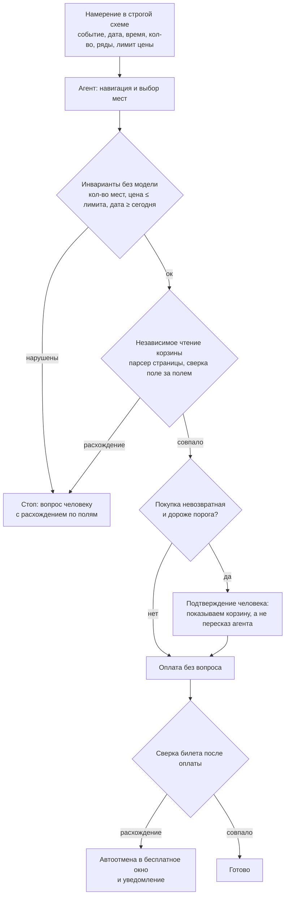

# A1. Агент бронирует билеты

**Вопрос.** Агент бронирует билеты на сайтах-афишах. В 5% прогонов сайт отдаёт другую вёрстку, и агент выбирает не то место или дату. Какие проверки нужны и в каком порядке, где обязательно подтверждение человека, что остаётся на совести агента, во что обходится каждая ступень (время пользователя, деньги, конверсия).

**Короткий ответ.** Лестница из пяти ступеней, от дешёвых к дорогим. Основную работу делают две ступени без модели и без участия человека:
- **инварианты** (сколько мест, цена не выше лимита, дата не в прошлом) ловят арифметику: единственный неверный заказ LLM-агента (2 билета вместо 3);
- **независимое чтение корзины** - парсер страницы корзины сверяет каждое поле с намерением. Он остановил все 10 неверных заказов хрупкого скрипта: тот на «сломанной» вёрстке взял сеанс другого события или не тот ряд, а цена и число мест были в порядке, и инварианты этого не видят.

Вместе на 900 прогонах они не пропустили к оплате ни одного неверного заказа и ни разу не остановили верный (0 из 838). Человека спрашиваем **только при расхождении** - это 0-0.3% прогонов. Подтверждение «на всякий случай» для дорогих заказов (выше 15 000 ₽) добавило вопрос ещё в 4.6-6.2% прогонов и не поймало ни одной ошибки. Его оставляю только для невозвратных покупок.

## Репро

**Сайт** ([`src/site/`](src/site)) - локальный мок афиши: 6 событий, 4 даты, до 3 сеансов в день, зал 12 × 16 мест, цены по зонам рядов, около 45% мест занято. Страницы: афиша → сеансы события → схема зала → корзина → оплата. Состояние и корзина - отдельно на каждый прогон.

**Вёрстки.** Основная и четыре «сломанные» - на тех же данных, но по-другому отображённые:
- **swap** - в таблице сеансов переставлены колонки даты и времени;
- **dateformat** - даты в американском формате `12/05/2026` (это 5 декабря) на русском сайте;
- **rows** - ряды пронумерованы от сцены снизу, подпись ряда справа от мест, места не сгруппированы по рядам;
- **promo** - в таблицу сеансов вставлена строка рекламы другого события с той же датой и временем и обычной кнопкой «Выбрать сеанс», на схеме зала - рекламный блок «Лучшие места».

Первая версия «сломанных» вёрсток оказалась слишком мягкой: на пилоте ноль ошибок. Я сделал их реалистичнее один раз, до полного прогона, и под модель не подстраивал.

**Намерения** ([`src/intent.ts`](src/intent.ts)) - 300 выполнимых заказов: событие, дата, время, 1-3 билета, зона рядов, лимит цены. Чётные - на основной вёрстке, нечётные - по очереди на четырёх сломанных, то есть 150 на 150. Итоговые доли пересчитаны на условие вопроса: сломанная вёрстка в 5% прогонов. Каждое намерение подаётся двумя способами:
- **свободным текстом**, как пишет человек: «Купи два билета на „Ревизор“ в субботу 5 декабря на 19:00, ряды с 4 по 8, не дороже 3600 ₽ за билет»;
- **строгой схемой** (JSON со всеми полями).

**LLM-агент** ([`src/agent.ts`](src/agent.ts)) - `deepseek-v4.1-flash` с инструментами браузера, как в Playwright MCP:
- `snapshot` - дерево доступности страницы и список кликабельных элементов с номерами `ref` и контекстом (строка таблицы или группа);
- `click(ref)`, `pay`, `give_up`.

Агент останавливается на оплате: `pay` фиксирует, что он готов платить, а дальше решает лестница. Лимит - 25 шагов.

Агенту не подсказано, чем «сломаны» вёрстки: в системном промпте нет слов про рекламу или формат дат. Собственная кнопка «Оплатить» сайта в браузере агента заблокирована, так что оплатить в обход лестницы он не может. Снимок страницы сокращается только в части дерева, список кликабельных элементов отдаётся целиком: ссылка на корзину видна всегда (это проверено тестом на каждой странице зала каждой вёрстки).

**Хрупкий скрипт** ([`src/script-agent.ts`](src/script-agent.ts)) - классическая автоматизация без модели, написанная под основную вёрстку. Его допущения обычны для таких скриптов:
- сеанс - первая строка таблицы, где есть дата в формате `дд.мм.гггг` и время;
- место принадлежит ряду, чья подпись «Ряд N» встретилась перед ним последней;
- цена - число перед «₽» в подписи места.

Схема намерения задаёт зону рядов включительным диапазоном `rowFrom..rowTo`; среди зон есть зона из одного ряда (ряд 6).

**Оценка.** Сервер записывает, что именно лежит в корзине в момент оплаты. Судья ([`src/judge.ts`](src/judge.ts)) сравнивает это с намерением поле за полем. Лестница ([`src/ladder.ts`](src/ladder.ts)) проигрывается на записанных прогонах: на каждой ступени видно, какой неверный заказ она бы остановила и сколько вопросов задала бы человеку.

## Результаты

900 прогонов: 600 у LLM-агента (300 намерений × 2 способа ввода, $2.74 на всё, сумма по записям прогонов) и 300 у скрипта. Полные таблицы - [results/summary.md](results/summary.md), сырые записи с корзиной и трассой каждого прогона - `results/runs-*.jsonl`.

**LLM-агент (`deepseek-v4.1-flash`).** Ошибок, дошедших до пользователя, - в пересчёте на 5% сломанной вёрстки. В скобках - сырые счётчики: основная вёрстка / сломанная.

| Ступень | Ошибок до пользователя | Вопросов человеку | + время пользователя на прогон | Потеря конверсии | $ модели на прогон |
|---|---|---|---|---|---|
| 0. Свободный текст, без проверок | 0.03% (0/150 / 1/150) | 0 | 0 | 0 | 0.0049 |
| 1. Строгая схема | 0 (0/150 / 0/150) | 0 | 0 | 0 | 0.0043 |
| 2. + инварианты | 0 | 0 | 0 | 0 | 0.0043 |
| 3. + чтение корзины | 0 | 0 | 0 | 0 | 0.0043 |
| 4. + подтверждение выше 15 000 ₽ | 0 | 4.6% | 1.4 с | 0.23% | 0.0043 |
| 5. + сверка после оплаты | 0 | 4.6% | 1.4 с | 0.23% | 0.0043 |

Ступени 2-5 в таблице посчитаны для строгой схемы: проверять корзину без полей намерения не с чем. Единственный неверный заказ был на свободном тексте, и его остановили бы инварианты (см. таблицу «каждая проверка сама по себе» ниже). Медиана времени агента - 15-16 с на прогон, медиана шагов - 6, медиана входных токенов - 66 тыс. на прогон при обоих способах ввода. Не дошли до оплаты 11 прогонов из 600 (7 на свободном тексте, 4 на схеме), все упёрлись в лимит 25 шагов. Это не ошибка, а работа, которую человеку придётся сделать руками.

**Хрупкий скрипт** (только строгая схема):

| Ступень | Ошибок до пользователя | Вопросов человеку |
|---|---|---|
| 1-2. Схема и инварианты | 0.33% (0/150 / **10/150**) | 0 |
| 3. + чтение корзины | **0** | 0.3% |
| 4-5. + подтверждение и сверка | 0 | 6.2% |

Что сломалось у скрипта на вёрстках:

| Вёрстка | Итог |
|---|---|
| dateformat | 38 из 38 - остановился сам: не нашёл дату в своём формате |
| promo | 4 из 37 оплатил сеанс **другого события** из рекламной строки, 2 остановились |
| rows | 6 из 37 оплатил **не тот ряд** - все с зоной из одного ряда: подпись ряда стоит справа, и скрипт приписал место соседнему ряду |
| swap | все верные: поиск по тексту строки устойчив к перестановке колонок |

**Каждая проверка сама по себе** - что она остановила бы, стоя одна (все оплаченные прогоны, без пересчёта на 5%; в скобках 95% интервал Уилсона):

| Проверка | Flash: ловит неверных | Скрипт: ловит неверных | Останавливает верных (Flash + скрипт) |
|---|---|---|---|
| Инварианты | 1/1 | 0/10 [0-28%] | 0/838 |
| Чтение корзины | 1/1 | 10/10 [72-100%] | 0/838 |
| Человек выше 15 000 ₽ (видит страницу корзины) | 0/1 | 0/10 [0-28%] | 0/838 |
| Сверка после оплаты | 1/1 | 10/10 [72-100%] | 0/838 |

Человек на пороге не поймал ничего: неверные заказы скрипта были дешевле 15 000 ₽, а неверный заказ Flash (2 билета по 1200 ₽ вместо 3) - тем более. Сверка после оплаты на стенде сравнивает билет с намерением, а билетом считается заказ на сервере - это допущение, а не замер.

**Что было не так в неверных заказах** (без проверок):

| Кто | Вёрстка, ввод | Ошибка |
|---|---|---|
| Flash | promo, свободный текст | 2 места вместо 3 (1) |
| скрипт | promo | сеанс другого события (4) |
| скрипт | rows | не тот ряд (6) |

**Первый прогон Flash был на стенде с дефектами.** Независимое ревью нашло, что зона рядов «с 4 по 8» в схеме читалась как два отдельных ряда, длинный снимок страницы обрезался вместе со ссылкой на корзину, в промпте была подсказка «не нажимай рекламу», а агент мог нажать собственную кнопку оплаты сайта. Тот прогон дал 4 неверных заказа из 595, все - не то число мест. После исправлений все 600 прогонов повторены, в отчёте только новые.

## Анализ

1. **Сильная модель на «сломанной» вёрстке почти не ошибается.** Flash сделал 1 ошибку из 589 оплаченных заказов, и она не про вёрстку: агент дважды проходил путь от афиши до зала и оплатил 2 места вместо 3. 5% ошибок из-за вёрстки, о которых говорит вопрос, на сильной модели не воспроизводятся. Вёрстка бьёт по скриптам и, скорее всего, по слабым моделям; слабую локальную модель на этом стенде прогнать не удалось (см. «Ограничения»).
2. **Строгая схема намерения - это не про точность агента** (1 ошибка на свободном тексте против 0 на схеме, в пределах шума). Её ценность в другом: только по схеме возможны ступени 2 и 3, без полей «кол-во», «ряды», «лимит» сверять корзину не с чем. Схема не дороже: медиана входных токенов одинаковая, $0.0043 против $0.0049 на прогон. Как надёжно извлечь схему из свободного текста, я не мерил: в прогонах схема подаётся готовой.
3. **Две ступени без модели закрывают разные ошибки.**
   - Инварианты ловят арифметику: число мест, цену, дату. Это ошибка Flash.
   - Чтение корзины ловит смысл: не то событие, не тот сеанс, не тот ряд. Это все 10 ошибок скрипта; инварианты не поймали ни одной из них.

   Обе ступени стоят миллисекунды, не тратят токены и на стенде ни разу не остановили верный заказ (0 из 838). Инварианты на стенде проверяют заказ, записанный сервером; в проде это должна быть корзина из API сайта или та же разобранная страница.
4. **Чтение корзины должно быть независимым.** Это парсер страницы, а не вопрос агенту «всё ли верно». Агент, который ошибся из-за вёрстки, читает ту же вёрстку, и вероятность повторить ту же ошибку высокая. Оговорка: на стенде страница корзины одинакова на всех вёрстках. Если сайт ломает и её, парсер тоже надо держать под тестами на поломку.
5. **Подтверждение «на всякий случай» - самая дорогая ступень и ничего не ловит.** Порог 15 000 ₽ задаёт вопрос в 4.6-6.2% прогонов, это 1.4-1.9 с времени пользователя на прогон и 0.23-0.31% потерянных покупок (по допущению), а ошибок не поймал ни одной. Человек подтверждает то, что видит на странице корзины: всё, что он мог бы заметить, уже заметил парсер, а если страница врёт, он подтвердит неверное.
6. **Сверка после оплаты - страховочная сетка** на случай, когда врёт сама корзина. Стоя одна, она поймала бы всё, но ценой отмены после оплаты (3 мин пользователя на каждую по допущению). Пока ошибок нет, она пользователю ничего не стоит.

## Решение

**Порядок проверок:**
1. **Намерение - в строгую схему до старта.** Агент не трактует свободный текст на ходу. Если поле не извлеклось однозначно (непонятно «на выходных»), вопрос задаётся до начала, а не после оплаты.
2. **Инварианты на каждом шаге и перед оплатой** - код, без модели: число мест, цена каждого ≤ лимита, дата ≥ сегодня, места не дублируются.
3. **Независимое чтение корзины перед оплатой** - парсер страницы корзины или API сайта, сверка с намерением поле за полем: событие, дата, время, ряды, цена.
4. **Подтверждение человека:**
   - **обязательно** - при любом расхождении на шагах 2-3, с показом, какое поле не совпало;
   - **обязательно** - если покупка невозвратная и дороже порога;
   - иначе - без вопроса.
5. **После оплаты** - сверка билета или письма с намерением. При расхождении - автоотмена в бесплатное окно и уведомление.

**На совести агента:** навигация по сайту, выбор между равноценными местами, выход «не могу» (`give_up`) вместо угадывания. **Не на совести агента:** решение «всё верно, плачу» - его принимают ступени 2-3.

**Цена ступеней** (на стенде, при 5% сломанной вёрстки):

| Ступень | Время пользователя | Деньги | Конверсия |
|---|---|---|---|
| 1. Схема | 0 | 0 (то же число вызовов модели) | 0 |
| 2. Инварианты | вопрос только при ошибке: 0 вопросов на стенде | 0 | 0 |
| 3. Чтение корзины | вопрос только при ошибке: 0.3% прогонов у скрипта, 0.1 с на прогон | 0 | ~0.02% |
| 4. Подтверждение по порогу | +1.4-1.9 с на прогон, 30 с на каждый вопрос | 0 | +0.23-0.31% |
| 5. Сверка после оплаты | 0, пока нет ошибок; 3 мин на отмену | 0 | 0 |

## Вывод

Гипотеза «лестница от дешёвых проверок к дорогим, человек - только при расхождении» подтвердилась. Неожиданным оказалось другое: у сильной модели вёрстка почти не вызывает ошибок (1 из 589, и та арифметическая - её ловят инварианты). Ошибки из-за вёрстки делает хрупкий скрипт, и их ловит только независимое чтение корзины. Две проверки кодом закрывают оба класса и не стоят пользователю почти ничего: вопрос задаётся только при настоящем расхождении. Подтверждение по сумме стоит в разы дороже и не добавляет ничего.

## Ограничения

- **«Сломанные» вёрстки придуманы мной,** четыре вида. Реальные сайты ломаются разнообразнее, и доля ошибок модели зависит от того, как именно.
- **Слабая локальная модель не прогнана.** `qwen3:8b` на этом стенде не годится: агент копит снимки страниц до 30 тыс. токенов, это упирается в окно модели в 32k, и один прогон занимает около 10 минут. Пилот я остановил.
- **Нули - это 0 из n.** 0 неверных заказов из ~300 даёт верхнюю границу 95% интервала около 1%. У Flash неверный заказ всего один, поэтому «инварианты ловят ошибки Flash» - это наблюдение на одном случае, а не оценка доли.
- **Страница корзины одинакова на всех вёрстках.** Поломки вёрстки на стенде касаются только афиши, сеансов и зала, поэтому парсер корзины на стенде не ломается. На живом сайте его надо проверять так же, как агента.
- **Извлечение схемы из свободного текста не измерено.** В прогонах со схемой она подаётся готовой.
- **Время ответа человека, потеря конверсии на вопросе и цена отмены не измеряются на стенде.** Это допущения: 30 с (15-60), 5% покупок на каждый вопрос (2-10%), 3 мин на отмену. Диапазоны - в [results/summary.md](results/summary.md).
- **Одна модель, один сэмпл** на намерение и способ ввода (temperature 0.7).
- **Оплата условная:** платёжного шлюза, возвратов и бесплатного окна отмены нет, автоотмена посчитана по записи.
