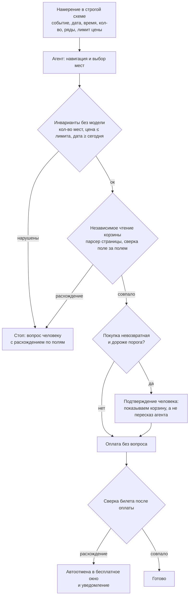

# A1. Агент бронирует билеты

**Вопрос.** Агент бронирует билеты на сайтах-афишах. В 5% прогонов сайт отдаёт другую вёрстку, и агент выбирает не то место или дату. Какие проверки нужны и в каком порядке, где обязательно подтверждение человека, что остаётся на совести агента, во что обходится каждая ступень (время пользователя, деньги, конверсия).

**Короткий ответ.** Лестница из пяти ступеней, от дешёвых к дорогим. Основную работу делают две ступени без модели и без участия человека:
- **инварианты** (сколько мест, цена не выше лимита, дата не в прошлом) остановили все неверные заказы LLM-агента;
- **независимое чтение корзины** - парсер страницы корзины сверяет каждое поле с намерением. Он остановил все неверные заказы хрупкого скрипта: тот на «сломанной» вёрстке взял сеанс другого события, и инварианты этого не видят.

Вместе на 1200 прогонах они не пропустили к оплате ни одного неверного заказа и ни разу не остановили верный. Человека спрашиваем **только при расхождении** - это 0.1-1.3% прогонов. Подтверждение «на всякий случай» для дорогих заказов (выше 15 000 ₽) добавило вопрос ещё в 4.6-5.9% прогонов и не поймало ни одной ошибки. Его оставляю только для невозвратных покупок.

## Репро

**Сайт** ([`src/site/`](src/site)) - локальный мок афиши: 6 событий, 4 даты, до 3 сеансов в день, зал 12 × 16 мест, цены по зонам рядов, около 45% мест занято. Страницы: афиша → сеансы события → схема зала → корзина → оплата. Состояние и корзина - отдельно на каждый прогон.

**Вёрстки.** Основная и четыре «сломанные» - на тех же данных, но по-другому отображённые:
- **swap** - в таблице сеансов переставлены колонки даты и времени;
- **dateformat** - даты в американском формате `12/05/2026` (это 5 декабря) на русском сайте;
- **rows** - ряды пронумерованы от сцены снизу, подпись ряда справа от мест, места не сгруппированы по рядам;
- **promo** - в таблицу сеансов вставлена строка рекламы другого события с той же датой и временем и обычной кнопкой «Выбрать сеанс», на схеме зала - рекламный блок «Лучшие места».

Первая версия «сломанных» вёрсток оказалась слишком мягкой: на пилоте ноль ошибок. Я сделал их реалистичнее один раз, до полного прогона, и под модель не подстраивал.

**Намерения** ([`src/intent.ts`](src/intent.ts)) - 300 выполнимых заказов: событие, дата, время, 1-3 билета, зона рядов, лимит цены. Чётные - на основной вёрстке, нечётные - по очереди на четырёх сломанных, то есть 150 на 150. Итоговые доли пересчитаны на условие вопроса: сломанная вёрстка в 5% прогонов. Каждое намерение подаётся двумя способами:
- **свободным текстом**, как пишет человек: «Купи два билета на „Ревизор“ в субботу 5 декабря на 19:00, ряды с 4 по 8, не дороже 3600 ₽ за билет»;
- **строгой схемой** (JSON со всеми полями).

**LLM-агент** ([`src/agent.ts`](src/agent.ts)) - `deepseek-v4.1-flash` с инструментами браузера, как в Playwright MCP:
- `snapshot` - дерево доступности страницы и список кликабельных элементов с номерами `ref` и контекстом (строка таблицы или группа);
- `click(ref)`, `pay`, `give_up`.

Агент останавливается на оплате: `pay` фиксирует, что он готов платить, а дальше решает лестница. Лимит - 25 шагов.

**Хрупкий скрипт** ([`src/script-agent.ts`](src/script-agent.ts)) - классическая автоматизация без модели, написанная под основную вёрстку. Его допущения обычны для таких скриптов:
- сеанс - первая строка таблицы, где есть дата в формате `дд.мм.гггг` и время;
- место принадлежит ряду, чья подпись «Ряд N» встретилась перед ним последней;
- цена - число перед «₽» в подписи места.

**Оценка.** Сервер записывает, что именно лежит в корзине в момент оплаты. Судья ([`src/judge.ts`](src/judge.ts)) сравнивает это с намерением поле за полем. Лестница ([`src/ladder.ts`](src/ladder.ts)) проигрывается на записанных прогонах: на каждой ступени видно, какой неверный заказ она бы остановила и сколько вопросов задала бы человеку.

## Результаты

600 прогонов LLM-агента (300 намерений × 2 способа ввода, $5.3 на всё) и 300 прогонов скрипта. Полные таблицы - [results/summary.md](results/summary.md), сырые записи с корзиной и трассой каждого прогона - `results/runs-*.jsonl`.

**LLM-агент (`deepseek-v4.1-flash`).** Ошибок, дошедших до пользователя, - в пересчёте на 5% сломанной вёрстки. В скобках - сырые счётчики: основная вёрстка / сломанная.

| Ступень | Ошибок до пользователя | Вопросов человеку | + время пользователя на прогон | Потеря конверсии | $ модели на прогон |
|---|---|---|---|---|---|
| 0. Свободный текст, без проверок | 0.64% (1/149 / 0/148) | 0 | 0 | 0 | 0.008 |
| 1. Строгая схема | 1.31% (2/149 / 1/149) | 0 | 0 | 0 | 0.011 |
| 2. + инварианты | **0** (0/149 / 0/149) | 1.3% | 0.4 с | 0.07% | 0.011 |
| 3. + чтение корзины | 0 | 1.3% | 0.4 с | 0.07% | 0.011 |
| 4. + подтверждение выше 15 000 ₽ | 0 | 5.9% | 1.8 с | 0.30% | 0.011 |
| 5. + сверка после оплаты | 0 | 5.9% | 1.8 с | 0.30% | 0.011 |

Медиана времени агента - 21-23 с на прогон, медиана шагов - 6. Не дошли до оплаты 3.5-4.4% прогонов, почти все упёрлись в лимит 25 шагов. Это не ошибка, а работа, которую человеку придётся сделать руками.

**Хрупкий скрипт** (только строгая схема):

| Ступень | Ошибок до пользователя | Вопросов человеку |
|---|---|---|
| 1-2. Схема и инварианты | 0.13% (0/150 / **4/150**) | 0 |
| 3. + чтение корзины | **0** | 0.1% |
| 4-5. + подтверждение и сверка | 0 | 6.0% |

Что сломалось у скрипта на вёрстках:

| Вёрстка | Итог |
|---|---|
| dateformat | 38 из 38 - остановился сам: не нашёл дату в своём формате |
| promo | 4 из 37 оплатил сеанс **другого события** из рекламной строки, 2 остановились |
| swap, rows | все верные: поиск по тексту строки и подписи цены оказались устойчивы |

**Что было не так в неверных заказах** (без проверок):

| Кто | Вёрстка, ввод | Ошибка |
|---|---|---|
| Flash | основная, свободный текст | лишнее место и не тот ряд (1) |
| Flash | основная, схема | не то число мест (2) |
| Flash | promo, схема | не то число мест (1) |
| скрипт | promo | сеанс другого события (4) |

## Анализ

1. **Сильная модель на «сломанной» вёрстке почти не ошибается.** Сломанная вёрстка дала Flash 1 ошибку из 297. Чаще он ошибался на основной вёрстке, и ошибки другого рода: не то число мест. Вёрстка из вопроса бьёт сильнее всего по скриптам и слабым моделям. Слабую локальную модель на этом стенде прогнать не удалось (см. «Ограничения»).
2. **Строгая схема намерения сама ошибок не снизила** (1.3% против 0.6%, в пределах шума: 3 и 1 заказ). Её ценность в другом: только по схеме возможны ступени 2 и 3. Без полей «кол-во», «ряды», «лимит» сверять корзину не с чем.
3. **Две ступени без модели закрывают разные ошибки.**
   - Инварианты ловят арифметику: число мест, цену, дату. Это все 4 ошибки Flash.
   - Чтение корзины ловит смысл: не то событие, не тот сеанс, не тот ряд. Это все 4 ошибки скрипта, которые инварианты пропустили: цена и число мест у чужого сеанса были в порядке.

   Обе ступени стоят миллисекунды, не тратят токены и на стенде ни разу не остановили верный заказ.
4. **Чтение корзины должно быть независимым.** Это парсер страницы, а не вопрос агенту «всё ли верно». Агент, который ошибся из-за вёрстки, читает ту же вёрстку, и вероятность повторить ту же ошибку высокая.
5. **Подтверждение «на всякий случай» - самая дорогая ступень и ничего не ловит.** Порог 15 000 ₽ задаёт вопрос ещё в 4.6-5.9% прогонов, это 1.8 с времени пользователя на прогон и 0.3% потерянных покупок (по допущению), а ошибок не поймал ни одной: все они уже остановлены ступенями 2-3. К тому же человек подтверждает то, что видит на странице корзины. Если страница сама врёт, он подтвердит неверное.
6. **Сверка после оплаты на стенде ничего не поймала,** потому что ступени 2-3 остановили всё раньше. Это страховочная сетка на случай, когда врёт сама корзина. Без ошибок она пользователю ничего не стоит.

## Решение

**Порядок проверок:**
1. **Намерение - в строгую схему до старта.** Агент не трактует свободный текст на ходу. Если поле не извлеклось однозначно (непонятно «на выходных»), вопрос задаётся до начала, а не после оплаты.
2. **Инварианты на каждом шаге и перед оплатой** - код, без модели: число мест, цена каждого ≤ лимита, дата ≥ сегодня, места не дублируются.
3. **Независимое чтение корзины перед оплатой** - парсер страницы корзины или API сайта, сверка с намерением поле за полем: событие, дата, время, ряды, цена.
4. **Подтверждение человека:**
   - **обязательно** - при любом расхождении на шагах 2-3, с показом, какое поле не совпало;
   - **обязательно** - если покупка невозвратная и дороже порога;
   - иначе - без вопроса.
5. **После оплаты** - сверка билета или письма с намерением. При расхождении - автоотмена в бесплатное окно и уведомление.

**На совести агента:** навигация по сайту, выбор между равноценными местами, выход «не могу» (`give_up`) вместо угадывания. **Не на совести агента:** решение «всё верно, плачу» - его принимают ступени 2-3.

**Цена ступеней** (на стенде, при 5% сломанной вёрстки):

| Ступень | Время пользователя | Деньги | Конверсия |
|---|---|---|---|
| 1. Схема | 0 | 0 (то же число вызовов модели) | 0 |
| 2. Инварианты | 0.4 с на прогон: вопрос только при ошибке | 0 | ~0.07% |
| 3. Чтение корзины | +0 сверх ступени 2 | 0 | ~0 |
| 4. Подтверждение по порогу | +1.4 с на прогон, 30 с на каждый вопрос | 0 | +0.23% |
| 5. Сверка после оплаты | 0, пока нет ошибок; 3 мин на отмену | 0 | 0 |

## Вывод

Гипотеза «лестница от дешёвых проверок к дорогим, человек - только при расхождении» подтвердилась. Неожиданным оказалось другое: у сильной модели вёрстка почти не вызывает ошибок, ошибки у неё арифметические, и их ловят инварианты. Ошибки из-за вёрстки делает хрупкий скрипт, и их ловит только независимое чтение корзины. Две проверки кодом закрывают оба класса и стоят пользователю меньше секунды на прогон. Подтверждение по сумме стоит в разы дороже и не добавляет ничего.

## Ограничения

- **«Сломанные» вёрстки придуманы мной,** четыре вида. Реальные сайты ломаются разнообразнее, и доля ошибок модели зависит от того, как именно.
- **Слабая локальная модель не прогнана.** `qwen3:8b` на этом стенде не годится: агент копит снимки страниц до 30 тыс. токенов, это упирается в окно модели в 32k, и один прогон занимает около 10 минут. Пилот я остановил.
- **Нули - это 0 из n.** 0 неверных заказов из ~300 даёт верхнюю границу 95% интервала около 1%.
- **Время ответа человека, потеря конверсии на вопросе и цена отмены не измеряются на стенде.** Это допущения: 30 с (15-60), 5% покупок на каждый вопрос (2-10%), 3 мин на отмену. Диапазоны - в [results/summary.md](results/summary.md).
- **Одна модель, один сэмпл** на намерение и способ ввода (temperature 0.7). 5 прогонов из 600 упали с сетевой ошибкой и в доли не входят.
- **Оплата условная:** платёжного шлюза, возвратов и бесплатного окна отмены нет, автоотмена посчитана по записи.
