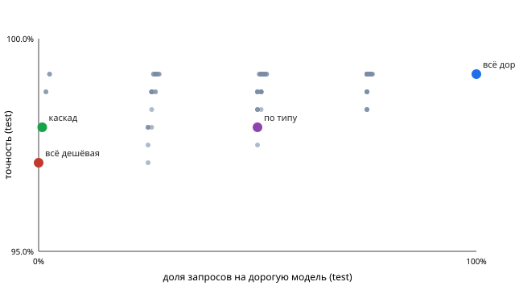

# A3. Маршрутизатор моделей

**Вопрос.** Локальная модель на части задач хуже платной, а платить за большую модель на всех запросах не хотят. По каким признакам маршрутизировать, как настроить по метрикам и как доказать заказчику, что качество не ухудшилось.

**Короткий ответ.** Каскад: сначала дешёвая модель, затем дешёвые проверки её ответа, а при провале - эскалация к дорогой. Плюс правило по типу задачи для тех типов, где дешёвая модель системно слабее.

Признаки маршрутизации:
- тип задачи;
- валидность JSON по схеме;
- согласие нескольких сэмплов дешёвой модели.

Настройка ведётся по train, где правило выбора рабочей точки задано заранее; итоговые цифры - на отложенном test.

На стенде (480 задач, быстрая локальная `qwen3:8b` и `deepseek-v4-pro`) выбранный каскад даёт 98.3% против 99.2% у «всё на дорогую». Он отправляет к дорогой 52% запросов, стоит $0.20 вместо $0.60 на 1000 запросов, а p50 задержки - 3.3 с против 3.5 с.

**Доказать не-худшесть с маржой 2 п.п. на 240 задачах test не получилось:** нижняя граница интервала -2.1 п.п. Это и есть честный ответ заказчику: роутер в точечной оценке хуже на 0.8 п.п., и потеря до 2.1 п.п. не исключена. Доказывать нужно теневым режимом в проде; симуляция на test даёт размер тени - около 1000 сравнений для мощности 80%.

## Репро

**Задачи** ([`src/tasks/`](src/tasks)) - 480 задач, по 120 каждого типа, у каждой есть автоматическая проверка ответа. Разбиение train/test 50/50 фиксированным seed.

| Тип | Что это | Проверка |
|---|---|---|
| classify | обращение в поддержку → одна из 6 категорий. Половина - «трудные»: отрицание («вопрос не про оплату»), два намерения с явным главным, вводящие в заблуждение слова | точное совпадение метки |
| extract | письмо о заказе → JSON по схеме (клиент, дата, сумма, валюта, число позиций) | JSON парсится, поля совпадают |
| math | 120 задач из публичного GSM8K (test, MIT), рассуждение разрешено | число в последней строке |
| qa | короткий ответ по абзацу: разница дат, сумма, сравнение, цена со скидкой; ответ «только число или имя» | число или имя |

**Модели:**

| Роль | Модель | Как запущена |
|---|---|---|
| дешёвая, основной вариант | `qwen3:8b` локально, рассуждения выключены (`reasoning_effort: none`) | 3 сэмпла: жадный и два при temperature 0.7 |
| дешёвая, второй вариант | та же `qwen3:8b` с рассуждениями | для сравнения |
| дорогая | `deepseek-v4-pro` | - |
| контроль | `deepseek-v4.1-flash` | - |

Ответы кешируются, отчёт пересобирается без сети.

**Роутер** ([`src/router.ts`](src/router.ts)) - политики над таблицей ответов:
- «всё на дешёвую»;
- «всё на дорогую»;
- правило по типу задачи, выученное на train;
- каскад - сетка из 96 конфигураций: требовать валидный JSON или нет, минимальное согласие сэмплов 1/2/3, какие типы всегда отправлять к дорогой.

Задержка каскада - время самого медленного из использованных сэмплов плюс вызов дорогой модели при эскалации. Локальная модель стоит $0 в предельных затратах.

**Выбор рабочей точки задан до просмотра test:** самая дешёвая конфигурация каскада, чья точность на train не ниже «всё на дорогую» минус 1 п.п. **Маржа не-худшести** тоже задана заранее - 2 п.п.

## Результаты

Полные таблицы - [results/summary.md](results/summary.md) (дешёвая без рассуждений) и [results/summary-qwen3_8b.md](results/summary-qwen3_8b.md) (дешёвая с рассуждениями), все точки - `results/policies*.csv`, сырые ответы - [results/answers.jsonl](results/answers.jsonl).

**Где дешёвая хуже** (жадный ответ, все 480 задач):

| Модель | classify | extract | math | qa | Все | p50 задержки |
|---|---|---|---|---|---|---|
| deepseek-v4-pro | 100% | 100% | 97.5%* | 100% | 99.4% | 3.5 с |
| deepseek-v4.1-flash | 100% | 100% | 97.5%* | 100% | 99.4% | 2.7 с |
| qwen3:8b с рассуждениями | 99.2% | 96.7% | 96.6% | 98.3% | 97.7% | **21.5 с** |
| qwen3:8b без рассуждений | 90.8% | 95.0% | 95.8% | **48.3%** | 82.5% | 2.6 с |

\* все три «ошибки» облачных моделей в math - спорные эталоны GSM8K (`math-005`, `math-030`, `math-038`): обе модели дали одинаковый ответ, который допускает текст задачи. На сравнение политик это не влияет - обе стороны ошибаются вместе.

**Политики на test** (дешёвая = `qwen3:8b` без рассуждений, 240 задач):

| Политика | Точность | Доля на дорогую | $ на 1000 запросов | p50 задержки |
|---|---|---|---|---|
| всё на дешёвую | 83.3% | 0% | 0 | 2.6 с |
| всё на дорогую | 99.2% | 100% | 0.599 | 3.5 с |
| правило по типу (на дорогую classify, extract, qa) | 98.3% | 75% | 0.310 | 3.7 с |
| **каскад:** classify и qa всегда на дорогую, остальное - дешёвая, при согласии всех 3 сэмплов | **98.3%** | **52%** | **0.203** | 3.3 с |

**Не-худшесть** (каскад − всё на дорогую, парный бутстреп, 10 000 повторов): −0.8 п.п., 95% интервал [−2.1; 0.0]. Маржа −2 п.п. - **не доказано**.

**С рассуждающей дешёвой моделью** картина другая. Выбранный каскад отправляет к дорогой 0.8% запросов и стоит $0.005 на 1000, точность 97.9%. Не-худшесть тоже не доказана: [−2.9; 0.0] п.п. При этом p50 задержки 23 с - в 6.5 раза медленнее дорогой модели.

## Анализ

1. **Где дешёвая хуже - видно по типам, и причина не всегда «модель глупее».** Без рассуждений `qwen3:8b` проваливает qa (48%): в формате «только число» ей негде посчитать, и разницу дат или цену со скидкой она угадывает. В math, где рассуждение разрешено в самом ответе, та же модель даёт 95.8%. Признак маршрутизации здесь - «задача требует вычисления, а формат ответа его запрещает». Гипотеза, которую я не проверял: этот признак исчезнет, если разрешить модели считать в ответе. Но и простое сложение трёх чисел без рассуждений даёт лишь 19 из 30 верных, так что дело не только в формате.
2. **Согласие сэмплов ловит неуверенность, но не устойчивую ошибку.** В 28 задачах из 240 (11.7%) дешёвая модель ответила одинаково неверно во всех трёх сэмплах. Такие ошибки никакой порог согласия не поймает. Поэтому каскад сам выбрал на train отправлять classify и qa к дорогой по типу. К тому же у быстрой модели разнообразие сэмплов низкое: в 168 задачах test из 240 все три ответа совпали побайтно, и согласие для неё - слабый признак.
3. **Валидность JSON работает как признак только против сбоев формата.** У быстрой модели JSON был валидным во всех 360 ответах extract, все 17 ошибок - в значениях полей. У рассуждающей 6 ответов из 360 - пустой `{}`: похоже на сбой связки «режим JSON + рассуждения» в Ollama, а не на качество модели. Именно их и ловит проверка схемы, и только они ушли к дорогой в её каскаде.
4. **Цена бывает не в деньгах.** Рассуждающая локальная модель почти так же точна, как дорогая, и не стоит ничего за токены (только своё железо), но отвечает за 21 с. Для интерактивного продукта это хуже, чем $0.6 на 1000 запросов. Выбор между двумя дешёвыми вариантами - это выбор между задержкой и долей дорогих вызовов, и решает его требование продукта к задержке.
5. **«Дорогая» модель на этих задачах не нужна:** `deepseek-v4.1-flash` даёт ту же точность (99.4%) в 6 раз дешевле и чуть быстрее (2.7 с против 3.5 с). Прежде чем строить роутер, стоит проверить, нужна ли дорогая модель вообще, или хватит дешёвой облачной.
6. **Почему 240 задач мало.** Роутер в точечной оценке действительно хуже на 0.8 п.п.: это 2 задачи из 240, где дешёвая ошиблась, а дорогая нет. При такой разнице до границы маржи остаётся 1.2 п.п., и интервал на 240 задачах шире. Симуляция теневого режима (те же парные разницы, то же правило решения) показывает: при наблюдаемой разнице 130 сравнений доказывают не-худшесть в 33% случаев, 1000 - в 92%. Оценка опирается всего на 2 расхождения, поэтому сама неточна - это ещё один довод собирать тень, а не спорить о формуле.

## Решение

**Признаки маршрутизации,** от дешёвых к дорогим:
1. **Тип задачи и формат ответа:** типы, где дешёвая модель системно слабее, сразу идут к дорогой (здесь - классификация с «трудными» обращениями и вычисления в формате «только ответ»).
2. **Проверки ответа дешёвой модели:** валидность по схеме, согласие 2-3 сэмплов (их можно запускать параллельно, задержка - самый медленный сэмпл), верификатор, где он есть: пересчитать арифметику, сверить извлечённые поля с текстом.
3. **Эскалация** к дорогой при провале любой проверки.

**Настройка по метрикам:**
- размеченный набор задач из продукта с автоматической проверкой, разбитый на train и test;
- **до** просмотра test фиксируются правило выбора рабочей точки и маржа не-худшести;
- рабочая точка подбирается на train, test считается один раз;
- кривая «доля на дорогую → качество» показывает заказчику, что он покупает за каждый процент дорогих вызовов.

**Как доказать заказчику:**
1. **Офлайн:** не-худшесть к «всё на дорогую» с заранее заданной маржой, парный бутстреп-интервал, плюс цена на 1000 запросов. Здесь - не доказано на 240 задачах, и это нормально, если сказать честно.
2. **Онлайн, теневой режим:** доля запросов роутера параллельно уходит к дорогой модели. Сравниваются ответы (где есть автоматическая проверка) или их расхождение. Симуляция на test с тем же правилом решения, что офлайн: при наблюдаемой разнице для мощности 80% нужно около 1000 сравнений; при 10% тени это около 10 000 запросов роутера. Это сравнения в пересчёте на весь трафик. Запросы, которые роутер и так отправил к дорогой, сравнивать не нужно (разница по определению 0), поэтому в тень достаточно отправлять запросы, оставленные дешёвой модели (здесь 48%), - около 500 таких сравнений. Это бюджет и срок, которые можно назвать заказчику заранее.
3. **В проде:** алерт, если доля расхождений в тени выходит за порог, и откат на «всё на дорогую» одним переключателем.

## Вывод

Гипотеза «каскад с дешёвыми проверками почти не теряет качества и стоит в разы меньше» подтвердилась частично:
- **подтвердилось:** каскад с быстрой дешёвой моделью стоит в 3 раза меньше и отвечает не медленнее; наблюдаемая потеря - 0.8 п.п., с рассуждающей - 1.3 п.п. без платы за токены;
- **не подтвердилось:** доказать не-худшесть с маржой 2 п.п. на 240 задачах не удалось ни для одного варианта. Значит, честный ответ заказчику - не «качество не хуже», а «на офлайн-наборе разница −0.8 п.п. [−2.1; 0], потеря до 2.1 п.п. не исключена; докажем или опровергнем в тени за ~1000 сравнений».

## Ограничения

- **Задачи classify, extract и qa сгенерированы мной** по шаблонам, math - публичный GSM8K. Продуктовые запросы разнообразнее, а доли ошибок по типам будут другими.
- **Модели и сэмплы:**
  - одна дешёвая модель в двух режимах;
  - дорогая и контроль - по одному жадному ответу;
  - температура сэмплов дешёвой - 0.7.
- **Стоимость локальной модели взята за $0** (предельная), железо и электричество не учтены.
- **Задержка измерена на одном Mac** с параллельной нагрузкой: другие прогоны делили ту же модель. Абсолютные секунды условны, соотношения - нет. Три сэмпла каскада считаются параллельными, и их задержка - самый медленный сэмпл; на одной локальной GPU одновременные генерации тормозят друг друга, так что реальная задержка каскада выше.
- **Первая попытка «быстрого» режима не выключала рассуждения:** Ollama 0.40 игнорирует переключатель `/no_think` в промпте. Эти ответы выброшены, режим выключается параметром запроса, на это есть тест.
