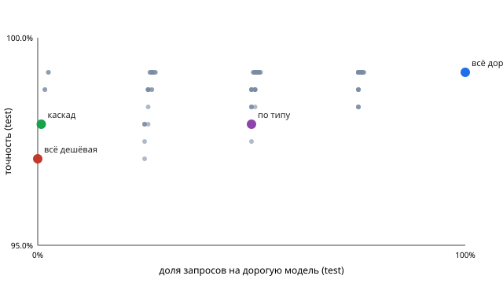

## Точность моделей по типам задач (жадный ответ, все 480 задач)

| Модель | classify | extract | math | qa | Все | Ошибки API |
|---|---|---|---|---|---|---|
| deepseek-v4-pro | 100.0% (120) | 100.0% (120) | 97.5% (120) | 100.0% (120) | 99.4% (480) | 0 |
| deepseek-v4.1-flash | 100.0% (120) | 100.0% (120) | 97.5% (120) | 100.0% (120) | 99.4% (480) | 0 |
| qwen3:8b | 99.2% (120) | 96.7% (120) | 96.6% (119) | 98.3% (120) | 97.7% (479) | 1 |
| qwen3:8b-nothink | 90.8% (120) | 95.0% (120) | 95.8% (120) | 48.3% (120) | 82.5% (480) | 0 |

Дальше: дешёвая = `qwen3:8b-nothink` (3 сэмпла), дорогая = `deepseek-v4-pro`. Задач в таблице маршрутизации: train 240, test 240 (задачи с ошибкой API у любой из моделей исключены для всех политик).

## Политики маршрутизации

Правило по типу и конфигурация каскада выбраны на train; test посчитан один раз. Стоимость локальной модели - $0 (предельная; железо и электричество не считаются).

| Политика | Точность train | Точность test | Доля на дорогую (test) | $ на 1000 запросов (test) | p50 задержки (test) |
|---|---|---|---|---|---|
| всё на дешёвую | 81.7% | 83.3% | 0.0% | 0.000 | 2.6 с |
| всё на дорогую | 99.6% | 99.2% | 100.0% | 0.599 | 3.5 с |
| правило по типу (classify→дорогая, extract→дорогая, math→дешёвая, qa→дорогая) | 99.6% | 98.3% | 75.0% | 0.310 | 3.7 с |
| **выбранный каскад**: cascade(json=нет, согласие≥3, всегда дорогая: classify+qa) | 98.8% | 98.3% | 52.1% | 0.203 | 3.3 с |

## Не-худшесть выбранного каскада (test, парный бутстреп, 10 000 повторов)

Разница точности «каскад − всё на дорогую»: -0.8 п.п., 95% интервал [-2.1; 0.0] п.п. Маржа задана заранее: −2 п.п. Вывод: **не доказано**, что не хуже: нижняя граница ниже −2 п.п..
Цена: 0.203 $ на 1000 запросов против 0.599 $ у «всё на дорогую»; на дорогую уходит 52.1% запросов.

Предел каскада по согласию: в test 28 из 240 задач (11.7%) дешёвая модель ответила одинаково неверно во всех трёх сэмплах - такие ошибки никакой порог согласия не поймает.

## Теневой режим в проде (симуляция на test)

Доля запросов роутера параллельно уходит к дорогой модели, ответы сравниваются. Симуляция: n теневых сравнений вытягиваются из парных разниц test, решение - то же, что офлайн (нижняя граница 95% интервала выше −2 п.п.). Вероятность доказать не-худшесть:

| Сравнений в тени | 130 | 240 | 500 | 1000 | 2000 | 4000 |
|---|---|---|---|---|---|---|
| если роутер хуже, как на test (-0.8 п.п.) | 32.7% | 67.3% | 75.7% | 91.8% | 99.9% | 100.0% |
| если разницы нет (расхождений столько же - 2, поровну в обе стороны) | 61.5% | 92.0% | 98.9% | 100.0% | 100.0% | 100.0% |

С мощностью 80% при наблюдаемой разнице нужно около **1000** сравнений; при 10% тени - 10000 запросов роутера.

## Кривая «доля на дорогую → качество»

Серые точки - все 96 конфигураций каскада на test; цветные - политики из таблицы. Файл: `results/frontier.svg`, все точки - `results/policies.csv`.

