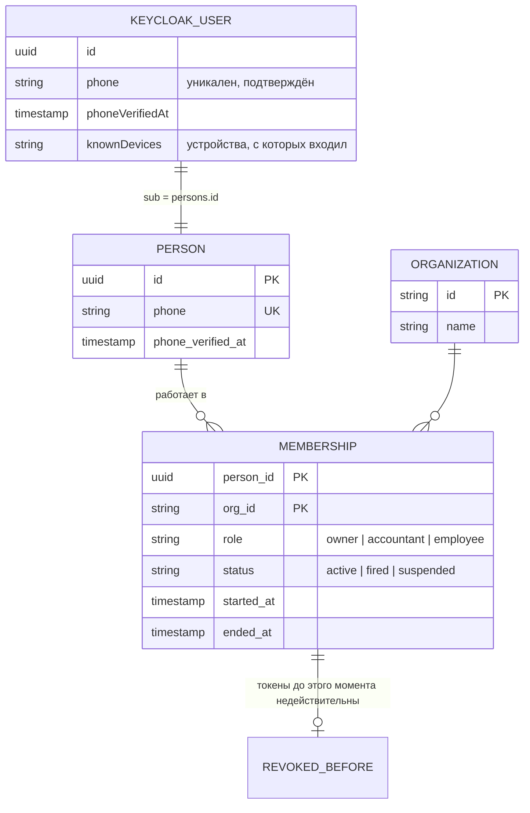
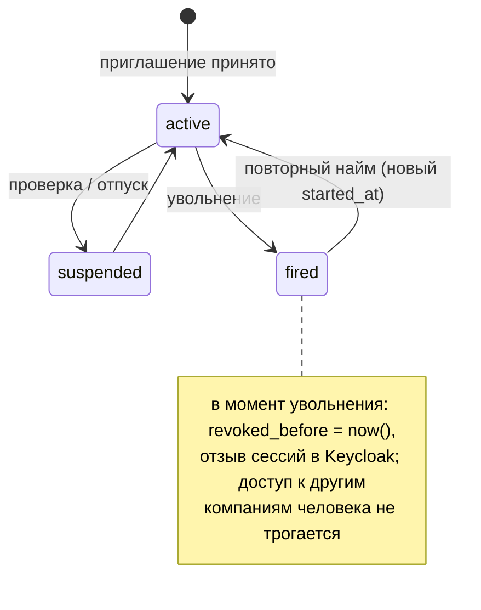
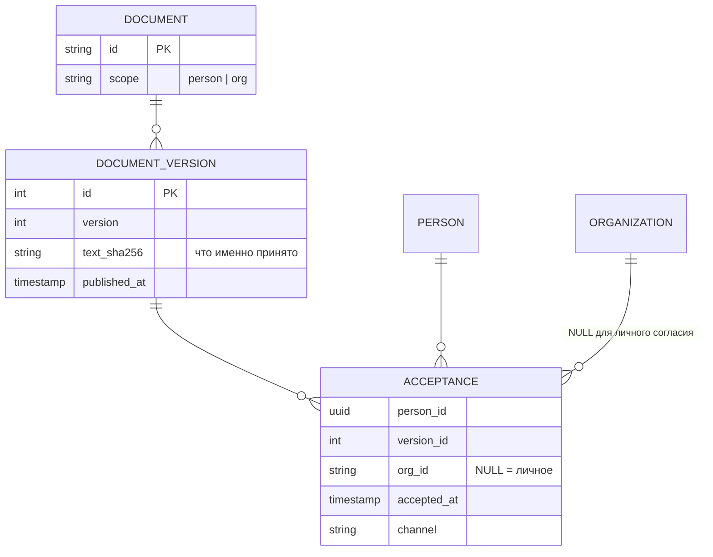

# B1. Один телефон - пять компаний

**Вопрос.** На один номер телефона заведены аккаунты в пяти юрлицах. Человек уволился из A и остался в Б. Кто входит по SMS-коду - номер, человек или роль? Какая модель данных в Keycloak и Postgres, где хранить согласия и их версии, что ломается при входе по SMS и как это чинить.

**Короткий ответ.** Номер подтверждает **человека**, а доступ к компании даёт **членство**: человек × компания × роль × статус. Согласие относится к версии документа и, если документ компанейский, к конкретной компании. На стенде все шесть сценариев воспроизводимо ломаются на «наивной» модели («аккаунт на компанию с одним номером») и проходят на исправленной. Результаты: [`results/scenarios.json`](results/scenarios.json).

## Репро

Стенд: `docker compose` поднимает Postgres 16 и Keycloak 26.8.2 (образ закреплён по digest). В Keycloak стоит собственное расширение [`keycloak-sms`](keycloak-sms/src/main/java/dev/aec/sms) (Java 21, 278 строк):

- эндпоинт выдачи кода `POST /realms/{realm}/sms/code`. Код из 6 цифр одноразовый, живёт 5 минут (на стенде 15 с). Лимиты на номер: 5 запросов кода и 5 неверных попыток за 10 минут. Ответ не выдаёт, существует ли номер;
- аутентификатор для direct grant: `phone` + `code` + `device_id` обмениваются на токен Keycloak. SMS-шлюз заменён «ящиком» стенда, из которого тест читает код.

Токен выдаёт только Keycloak, API проверяет его подпись по JWKS. Два realm с одним и тем же расширением:

| | naive (как обычно делают первым) | fixed |
|---|---|---|
| Пользователи Keycloak | по одному на компанию, у всех один `phone` | один на человека, `phone` уникален и подтверждён (`phoneVerifiedAt`) |
| Вход по SMS | первый найденный пользователь с этим номером | ровно один владелец номера; давно подтверждённый номер на новом устройстве → `step_up_required` |
| Доступ к компании | claim `org` из учётки, под которой вошли | активное членство в `memberships` проверяется на каждом запросе; токены, выданные до увольнения, отвергаются (`revoked_before`) |
| Увольнение | выключить учётку этой компании | статус `fired` + `revoked_before` + отзыв сессий в Keycloak |
| Согласие | флаг «принято» на номер телефона | принятие = человек × версия документа × компания |

Сценарии - [`tests/stand/scenarios.test.ts`](tests/stand/scenarios.test.ts). Все проверки идут через настоящий Keycloak и настоящий API, никаких заглушек авторизации. Прогон: `pnpm --filter b1-phone-orgs run case` (сборка расширения, чистый стек, тесты), то же в CI (job `b1-stand`).

## Результаты

| | Сценарий | naive | fixed |
|---|---|---|---|
| S1 | Вход по номеру, человек в 5 компаниях | вошла в учётку одной компании (A), остальные 4 недоступны | вошла как человек, доступны A-E |
| S2 | Уволена из A, осталась в Б | после увольнения старый токен открывает A: **HTTP 200** | тем же токеном A: 403, Б: 200 |
| S3 | Согласие, принятое в A | в Б засчитано без принятия: **HTTP 200** | Б требует принять: 428 |
| S4 | Новая версия согласия | старое «принято» действует: **HTTP 200** | до принятия v2: 428, после: 200 |
| S5 | Номер переназначен оператором | новый владелец вошёл и открыл данные компании: **HTTP 200** | новое устройство: `step_up_required`; прежний владелец со своего устройства входит |
| S6 | Второй человек с тем же номером | дубль создан, второй человек по своему коду попал в чужую компанию (D вместо E) | заведение дубля: 409 |

Кроме сценариев, тестами стенда покрыты: одноразовость кода, блокировка после 5 неверных кодов, лимит запросов кода, истечение кода, неразличимость «номер есть / номера нет» (18 тестов, все зелёные). Что тесты не пустые, проверено мутациями: если сделать код многоразовым, падает тест одноразовости; если API перестаёт смотреть на статус членства и `revoked_before`, падает S2.

## Анализ: что ломается при входе по SMS

1. **Номер - не учётная запись.** Если пользователей Keycloak столько, сколько компаний, то SMS-код подтверждает владение номером, но не говорит, *в какую* из пяти учёток входить. Keycloak выбирает первую найденную (S1), а при дубле номера человек оказывается в чужой компании (S6).
2. **Токен переживает увольнение.** JWT проверяется подписью, и выключенная учётка не отзывает уже выданный токен. Пока он не истёк, уволенный работает (S2). Короткий TTL сужает окно, но не закрывает его.
3. **Согласие без версии и без компании.** Флаг «принято» на номер «переезжает» между компаниями (S3) и переживает смену текста документа (S4). Юридически это согласие на другой документ от имени другой компании.
4. **Номер переходит к другому человеку.** Операторы переназначают номера после долгого неиспользования. Один SMS-фактор отдаёт новому владельцу весь доступ старого (S5).

## Решение

**Кто входит.** Человек. Один пользователь Keycloak на человека, `phone` - его подтверждённый уникальный атрибут (уникальность держится на заведении: дубль даёт 409; в Postgres - `UNIQUE` на `persons.phone`). Роль входом не является: роль - свойство членства в компании.

**Модель данных** (Keycloak - личность, Postgres приложения - доступ и согласия):

Схема в SQL - [`db/001_app.sql`](db/001_app.sql).

**Активная компания** выбирается после входа (на стенде - сегмент пути `/orgs/:org`), а API на каждом запросе проверяет членство и `revoked_before`. Здесь я сознательно отошёл от варианта «компания в токене». Проверка на API закрывает S2 сразу, независимо от срока токена. Роли и статусы в компании - бизнес-данные с историей и аудитом, им место в базе приложения. **Альтернатива:** Keycloak Organizations (`organization:<alias>` в scope) кладёт выбранную компанию в токен и годится, если ролей внутри компании нет, а отзыв по сроку токена устраивает. Проверку на API она всё равно не отменяет.

**Увольнение:** статус `fired` + `revoked_before` + отзыв сессий пользователя в Keycloak. Другие компании человека не затрагиваются (S2: Б работает тем же токеном).

**Согласия:** версия документа с хешем текста и принятие на (человек, версия, компания). Доступ к функции требует принятия *последней* версии в *этой* компании (S3, S4).

**Переназначенный номер:** номер, подтверждённый больше 90 дней назад, на незнакомом устройстве не даёт входа одним SMS - нужен второй фактор (`step_up_required`, S5). В проде ещё полезны сигналы оператора о смене владельца номера и повторное подтверждение номера раз в N месяцев.

## Вывод

Гипотеза подтвердилась на всех шести сценариях: «номер = человек, доступ = членство, согласие = версия × компания» закрывает то, что на наивной модели воспроизводимо ломается. Самая опасная поломка - S2: увольнение «на бумаге» при живом токене. Она не лечится коротким TTL, нужна проверка членства на каждом запросе.

## Ограничения

- Вход на стенде - direct grant (обмен кода на токен одним запросом), а не браузерный поток Keycloak. Логика выбора пользователя в обоих потоках одна, но экраны выбора компании и step-up на стенде не реализованы: проверяется только отказ `step_up_required`.
- SMS-шлюза и данных оператора о переназначении номеров нет. Правило «90 дней + новое устройство» - эвристика, её порог подбирается по реальным данным.
- Отзыв сессий в Keycloak при увольнении закрывает все сессии человека, в том числе в других компаниях: ему придётся войти заново. Точечный отзыв делается через `revoked_before` на API.
- Расширение использует внутренние SPI Keycloak (`realm-restapi-extension`, `authenticator`) - при обновлении Keycloak его надо пересобирать и прогонять тесты стенда.
